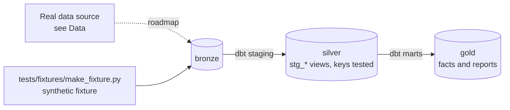

# Merchant Risk-Rating Controls

[](https://github.com/Saigwe/merchant-risk-controls/actions/workflows/ci.yml)

> A rules-based merchant risk rating with a maker-checker override workflow, period locks and a full audit trail, plus the regression test that would have caught a 3x overstatement bug.

**Author:** Stanley Igwe, Lead Data (Analytics) Engineer · [Portfolio](https://saigwe.github.io)
**Stack:** Postgres or DuckDB · dbt Core (snapshots for SCD2 history) · Streamlit or FastAPI · pytest
**Status:** 🚧 Scaffolded. Fixture pipeline passes: `dbt build` 20/20. See [Roadmap](#roadmap).

Project 2 of my portfolio plan. At a US food-delivery company I replaced a spreadsheet upload with a control app for ~20k merchant accounts (override sign-off, period locks, audit trail) and fixed a model bug that overstated newly high-risk accounts ~3x. This repo rebuilds the problem on public and synthetic data. No employer or client data, code or logic is used.

---

## 90-second summary
| | |
|---|---|
| **Problem** | TODO: one sentence on the business problem. |
| **What I built** | TODO: fill in as the roadmap lands. |
| **Why it matters** | TODO: the decision this enables, in the user's words. |
| **Proof** | TODO: link to [Numbers](#numbers), with every claim reproducible. |

## Architecture


## Data
Synthetic merchants, monthly risk scores and analyst overrides from the fixture generator. Plant a scoring bug to show the spike test catching it.

| Bronze table (fixture) | Rows |
|---|---|
| `bronze.merchants` | 400 |
| `bronze.risk_scores` | one per merchant per `MS` period, 2025-01-01 to 2025-06-01 |
| `bronze.overrides` | 150 |

## Data model (gold layer, first cut)
| Model | Purpose |
|---|---|
| `fct_merchant_risk_rating` | One row per merchant and month: model rating, the approved override (if any) and the final rating. |
| `rpt_new_high_risk_by_month` | Merchants newly rated high in each month (high now, not high the month before). |

## Tests in place
- Staging: `unique` / `not_null` on every key, and `relationships` on every foreign key
- Marts: grain tests (`unique_combination`) and accepted values
- Business rules: `assert_overrides_follow_maker_checker`, `assert_new_high_risk_not_spiking`

## Numbers
*(Fill from real runs. Never estimate.)*
| Metric | Value |
|---|---|
| Rows processed (real data) | _tbd_ |
| dbt models / tests | _tbd_ |
| `dbt build` runtime | _tbd_ |

## How to run
Requires **Python 3.12** (what CI uses) and `make`, or run the commands in the `Makefile` by hand.
```bash
python -m venv .venv && source .venv/bin/activate   # Windows: .venv\Scripts\activate
pip install -r requirements.txt
make fixture-all   # synthetic fixture -> dbt build (used in CI)
```

## Roadmap
- [x] Scaffold: synthetic fixture, staging with key tests, first marts and business-rule tests, CI
- [ ] Rules-based risk score model with documented thresholds
- [ ] Override workflow: maker proposes, checker approves, reason required (tested)
- [ ] Period locks: block edits to closed months
- [ ] Append-only audit log and dbt snapshots for SCD2 history of ratings
- [ ] Regression test on the month-on-month change in new high-risk accounts (the 3x bug guard)
- [ ] Streamlit approval screen and a 2-minute video
- [ ] Fill in [Numbers](#numbers) and the [design doc](docs/design_doc.md)
- [ ] 3-minute Loom walkthrough

## Interview topics this project prepares
- SCD Type 2 and snapshots
- Maker-checker controls
- Idempotent pipelines
- Testing for silent logic bugs

## Data and licence
- **Fixture:** synthetic, generated with a fixed seed by `tests/fixtures/make_fixture.py` from `fixture_spec.yml`. It describes no real company or person.
- **Real data:** see [Data](#data) for each source's own licence and terms.
- **Code:** MIT (see `LICENSE`).
