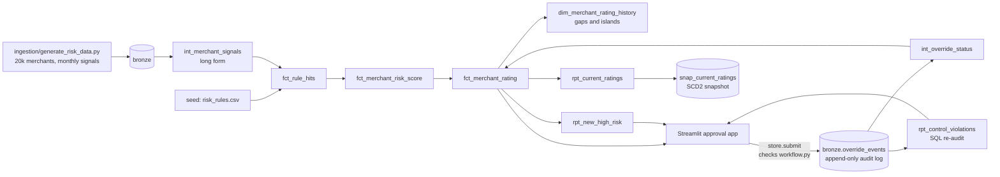

# Merchant Risk-Rating Controls

[](https://github.com/Saigwe/merchant-risk-controls/actions/workflows/ci.yml)

> Rules-driven risk ratings for 20,000 merchants with controlled overrides. An analyst proposes, a different checker approves, closed months are locked, every action lands in an append-only audit log, and dbt re-audits that log independently. Includes the test that would have caught a "newly high-risk ×3" reporting bug.

**Author:** Stanley Igwe, Lead Data (Analytics) Engineer · [Portfolio](https://saigwe.github.io)
**Stack:** Python · dbt Core (seeds, snapshots, unit tests) · DuckDB · Streamlit · pytest · GitHub Actions
**Status:** Core build complete and run at full scale (20,000 merchants, 12 months). See [Roadmap](#roadmap).

Based on work I did at a US food-delivery company, where I replaced a spreadsheet upload with a control app for ~20k merchant accounts (override sign-off, period locks, audit trail) and fixed a model bug that overstated newly high-risk accounts ~3×. This repo rebuilds the problem on **synthetic data**; no employer data, code or logic is used.

---

## 90-second summary
| | |
|---|---|
| **Problem** | Risk ratings were overridden through a spreadsheet upload: no sign-off, no lock on closed months, no history. A bad join silently inflated the count of newly high-risk merchants. |
| **What I built** | Scoring rules held as data (a dbt seed), monthly ratings with approved overrides applied, an approval app that enforces maker-checker, reasons and period locks, an append-only audit log, a SQL audit of that log, type-2 rating history, and a reconciliation test on newly high-risk counts. |
| **Why it matters** | Every rating can be explained (which rules fired) and every change traced (who proposed, who approved, why, when). A broken report fails the build instead of reaching the risk committee. |
| **Proof** | 54 dbt checks and 20 pytest tests. An answer-key test plants five kinds of control breach and requires dbt to report exactly those. The real 2,994-event log has 0 violations. See [Numbers](#numbers). |

## Architecture


## How a rating is made
- **Signals per merchant and month:**
  - chargeback and refund rates
  - negative-balance days
  - tenure
  - ownership change in the last 3 months
  - expired KYC
  - GMV growth
- **Rules are data.** `seeds/risk_rules.csv` holds eight rules (signal, operator, threshold, points). Signals are unpivoted to long form and joined to the rules, so changing a threshold or weight needs no SQL. The thresholds are illustrative, chosen for this synthetic data.
- **Score** = the sum of points, capped at 100. A score of 50 or more is **high** and 25 or more is **medium**. Each rating lists the rules that fired, highest weight first.
- **Final rating** = the approved override if there is one, otherwise the model rating.

## Controls
| Control | Enforced in the app (`app/workflow.py`, pytest) | Re-audited in dbt (`rpt_control_violations`) |
|---|---|---|
| Maker-checker: approver ≠ proposer | ✓ | `self_approval` |
| Only checkers approve or reject | ✓ | `unauthorised_approver` |
| Reason (10+ characters) to propose, reject or withdraw | ✓ | `missing_reason` |
| Period locks: nothing changes after a month locks | ✓ | `locked_period_edit` |
| One live override per merchant and month | ✓ | `duplicate_live_override` |
| Valid sequence (propose → one decision) | ✓ | `invalid_sequence` |
| Only the proposer withdraws | ✓ | `withdraw_by_non_proposer` |
| Known users only | ✓ | `unknown_user` |

The app writes through `store.submit`, which checks the event and inserts it in one transaction; a refused event writes nothing. dbt checks the same rules again over the whole log. A write that bypassed the app, or a bug in it, still fails the build (`assert_no_control_violations`).

## The "newly high-risk" bug and its guard
`rpt_new_high_risk` splits each month's high-risk merchants into **continuing** (high last month too) and **new**. If the prior-month join silently matches nothing (a date-type mismatch or an off-by-one month), every high merchant looks new. On this data that would overstate newly high-risk merchants by **1.9–2.4× every month**: 2,155 instead of 899 in December.

`assert_new_high_risk_reconciles` fails the build on any of three conditions:
- total ≠ new + continuing
- continuing exceeds last month's total
- new jumps more than 3× month on month

A unit test pins down the edge cases: onboarding, a gap month, medium to high.

## Tests
- **pytest, 20 tests:**
  - every workflow rule: self-approval, roles, reasons, locks, duplicates, sequence, withdrawal
  - the DuckDB store: a refused event writes nothing, events append in order
- **Answer key (CI fixture):** the fixture plants a self-approval, a missing reason, a locked-period edit, an analyst approval and a duplicate live override. `assert_planted_violations_detected` requires each to be reported under exactly that control, and nothing else.
- **dbt unit tests:**
  - score = rule points capped at 100, with rules listed by weight
  - the new-vs-continuing edge cases
  - gaps-and-islands rating history
- **Business rules:**
  - the audit log is append-only (ids never go back in time)
  - every score equals its rule hits
  - the newly-high-risk reconciliation
- **Generic tests:** keys, accepted values, relationships.

## Verified end to end in the app
I tested the flow by hand in the running app:
1. **Propose:** as `analyst_1`, I proposed lowering M000124 from high to medium for December, with a reason.
2. **Refused self-approval:** the same user's **Approve** was refused: "only a checker can approve or reject".
3. **Approve:** as `checker_1`, I approved it.
4. **Rebuild:** the final rating became medium (source: override), the snapshot recorded both versions, and the audit stayed at 0 violations.

These events were then discarded, so the numbers below come from freshly generated data.

## Numbers
From real runs on a Windows laptop (DuckDB, dbt 1.11). Reproduce with `make all`; the data is deterministic (seed 202).

| Metric | Value |
|---|---|
| Merchants / merchant-months rated | 20,000 / 223,037 |
| Rule hits | 104,931 (R03 refunds most frequent: 29,763) |
| Overrides / audit-log events | 1,500 / 2,994 |
| Approved / rejected / withdrawn / pending | 1,135 / 289 / 70 / 6 |
| Approval rate / median time to decision | 79.7% / 25 hours (median of monthly medians) |
| Approved overrides that changed the rating (the rest confirmed the model) | 677 |
| Control violations in the real log | **0** |
| Rating-history rows (type 2) | 38,953 |
| Generate data / `dbt build` | 3 s / 3.4 s, all 54 checks passing (about 14 s wall clock) |

**December 2025 final ratings:**

| Rating | high | medium | low |
|---|---|---|---|
| Merchants | 2,155 | 641 | 17,204 |

**Newly high-risk vs continuing, by month:**

| Month | Jan* | Feb | Mar | Apr | May | Jun | Jul | Aug | Sep | Oct | Nov | Dec |
|---|---|---|---|---|---|---|---|---|---|---|---|---|
| Total high | 907 | 1,125 | 1,220 | 1,384 | 1,459 | 1,637 | 1,682 | 1,830 | 1,896 | 1,961 | 2,026 | 2,155 |
| New | 907 | 591 | 552 | 651 | 682 | 733 | 713 | 800 | 786 | 848 | 839 | 899 |
| Continuing | 0 | 534 | 668 | 733 | 777 | 904 | 969 | 1,030 | 1,110 | 1,113 | 1,187 | 1,256 |

\* January is the first month of data, so every high merchant counts as new. High-risk counts rise through the year because the generator lets more merchants drift into risk than recover; that's an assumption of the synthetic data, not a finding.

## How to run
Requires **Python 3.12** (what CI uses) and `make`, or run the commands in the `Makefile` by hand.
```bash
python -m venv .venv && source .venv/bin/activate   # Windows: .venv\Scripts\activate
pip install -r requirements-app.txt
make all          # pytest -> generate 20k merchants -> dbt build
make app          # approval app on http://localhost:8501 (pick a user in the sidebar)
make fixture-all  # CI: pytest + planted violations + answer-key build
```
After approving overrides in the app, run `make dbt` to see them in the ratings and snapshot.

## Roadmap
- [x] Rules-as-data scoring with documented thresholds; ratings with approved overrides applied
- [x] Maker-checker workflow with reasons, period locks and an append-only audit log (pytest)
- [x] Independent SQL re-audit of the log, with an answer-key test on planted breaches
- [x] Type-2 rating history (gaps and islands) and a dbt snapshot of current ratings
- [x] "Newly high-risk" reconciliation guard and unit tests
- [x] Streamlit approval app, verified end to end
- [ ] 2-minute video of the approval flow
- [ ] Back-test: precision of high ratings against a later loss or termination label
- [ ] Postgres as the app's store, with row-level permissions per role
- [ ] 3-minute Loom walkthrough ([script ready](docs/walkthrough.md))

## Interview topics this project prepares
- SCD Type 2: dbt snapshots and gaps-and-islands history
- Maker-checker controls, period locks and audit trails
- Defence in depth: enforce in the app, re-audit in the warehouse
- Rules as data (unpivot plus join) instead of hard-coded logic
- Testing for silent logic bugs: reconciliation identities and answer keys

## Data and licence
- **Data:** fully synthetic, generated with a fixed seed. Merchants, signals and users are invented. The rule thresholds are illustrative and not any card scheme's programme.
- **Code:** MIT (see `LICENSE`).
